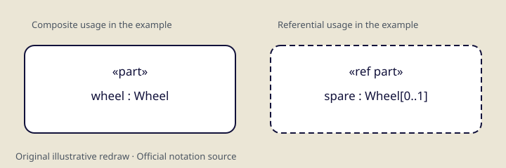
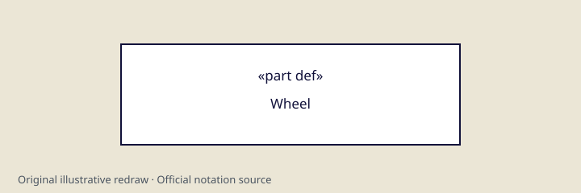
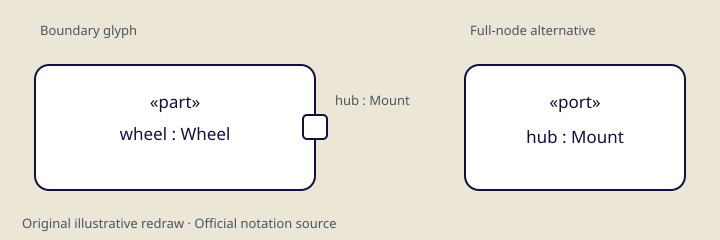
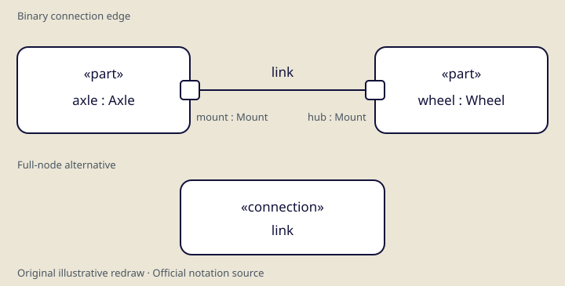

# Graphical notation coverage

A source index and review ledger for OMG SysML 2.0 Part 1, **formal/2026-03-02**. Indexed material is a work queue, not a claim that every visual alternative has been described or drawn.

**192 labeled source cells** across **26 Clause 7 tables**; **639 graphical grammar production occurrences** under **523 names**, across **27 subsections**.

Current curated coverage: **6 grouped notation records**, **4 SVG files**, **23 mapped production occurrences**, **7 mapped source cells**. Mappings provide representative support; none establishes exhaustive coverage of a source cell or production.

Notation records are counted independently of evidence links. A record may group several forms; a mapping does not exhaust all alternatives in its source.

Unmapped work queue: **185 labeled source cells** and **616 production occurrences**. These are two overlapping source inventories, not numbers to add into a missing-symbol total.

## Counting and review stages

| Unit | Count | Meaning |
|---|---:|---|
| Representative notation cells | 182 | Labeled cells in the 24 representative notation tables; alternatives inside a cell remain to be split |
| Control-node dependency cells | 4 | Table 16 supplies semantic keyword mappings, not graphical figures |
| Diagram-example cells | 6 | Table 25, including two distinct matrix examples |
| Production occurrences | 639 | Every declaration occurrence, including helpers and distributed partial rules |
| Explicit partial markers | 97 | Literal `=¦`; five spaced-bar forms and 19 reversed `¦=` forms are flagged for review |

**Indexed → described → illustrated → source-checked** applies to a declared variant scope. Source-cell and production mappings are counted separately; a small redraw does not complete all alternatives, compartments or nesting rules in its source. The bounded [parts-and-ports audit](parts-ports-notation-audit.md) records all local alternatives and explicit rendering/dependency deferrals for 12 source cells and 38 production occurrences. Audited does not mean fully rendered, dependency-complete or model-valid. A description can be source-checked without a local illustration.

The source-cell count retains distinct labeled cells and repeated labels. It excludes column headers and makes no inferred continuation joins. It is not a count of unique symbols, logical variants, or remaining drawings. See the [counting method](research/notation-coverage-method.md) and [machine-readable extraction index](../data/notation-source-index.json).

## Coverage by family

| Family | Grammar occurrences | Labeled source cells | Mapped grammar | Mapped cells | Audited grammar | Audited cells |
|---|---:|---:|---:|---:|---:|---:|
| [8.2.3.1 Graphical Notation Overview](notation-register.md#8231) | 0 | 0 | 0 | 0 | 0 | 0 |
| [8.2.3.2 Elements and Relationships](notation-register.md#8232) | 9 | 0 | 0 | 0 | 0 | 0 |
| [8.2.3.3 Dependencies](notation-register.md#8233) | 9 | 2 | 0 | 0 | 0 | 0 |
| [8.2.3.4 Annotations](notation-register.md#8234) | 12 | 10 | 0 | 0 | 0 | 0 |
| [8.2.3.5 Namespaces and Packages](notation-register.md#8235) | 25 | 12 | 0 | 0 | 0 | 0 |
| [8.2.3.6 Definition and Usage](notation-register.md#8236) | 31 | 24 | 0 | 0 | 0 | 0 |
| [8.2.3.7 Attributes](notation-register.md#8237) | 10 | 3 | 0 | 0 | 0 | 0 |
| [8.2.3.8 Enumerations](notation-register.md#8238) | 9 | 3 | 0 | 0 | 0 | 0 |
| [8.2.3.9 Occurrences](notation-register.md#8239) | 50 | 10 | 0 | 0 | 0 | 0 |
| [8.2.3.10 Items](notation-register.md#82310) | 12 | 3 | 0 | 0 | 0 | 0 |
| [8.2.3.11 Parts](notation-register.md#82311) | 18 | 8 | 5 | 3 | 18 | 8 |
| [8.2.3.12 Ports](notation-register.md#82312) | 20 | 4 | 9 | 1 | 20 | 4 |
| [8.2.3.13 Connections](notation-register.md#82313) | 39 | 13 | 9 | 3 | 0 | 0 |
| [8.2.3.14 Interfaces](notation-register.md#82314) | 17 | 6 | 0 | 0 | 0 | 0 |
| [8.2.3.15 Allocations](notation-register.md#82315) | 14 | 5 | 0 | 0 | 0 | 0 |
| [8.2.3.16 Flows](notation-register.md#82316) | 30 | 5 | 0 | 0 | 0 | 0 |
| [8.2.3.17 Actions](notation-register.md#82317) | 72 | 26 | 0 | 0 | 0 | 0 |
| [8.2.3.18 States](notation-register.md#82318) | 46 | 11 | 0 | 0 | 0 | 0 |
| [8.2.3.19 Calculations](notation-register.md#82319) | 14 | 2 | 0 | 0 | 0 | 0 |
| [8.2.3.20 Constraints](notation-register.md#82320) | 26 | 5 | 0 | 0 | 0 | 0 |
| [8.2.3.21 Requirements](notation-register.md#82321) | 68 | 8 | 0 | 0 | 0 | 0 |
| [8.2.3.22 Cases](notation-register.md#82322) | 4 | 0 | 0 | 0 | 0 | 0 |
| [8.2.3.23 Analysis Cases](notation-register.md#82323) | 12 | 3 | 0 | 0 | 0 | 0 |
| [8.2.3.24 Verification Cases](notation-register.md#82324) | 23 | 7 | 0 | 0 | 0 | 0 |
| [8.2.3.25 Use Cases](notation-register.md#82325) | 22 | 4 | 0 | 0 | 0 | 0 |
| [8.2.3.26 Views and Viewpoints](notation-register.md#82326) | 39 | 13 | 0 | 0 | 0 | 0 |
| [8.2.3.27 Metadata](notation-register.md#82327) | 8 | 5 | 0 | 0 | 0 | 0 |

## Reviewed representative records

### Composite and referential part usages

Rounded rectangle with a part usage label. The referential variant has a dashed outline and the ref prefix. Compartments and side ports are additional variants.

Illustrated forms: One solid composite part node and one dashed referential part node.



| Property | Recorded rule |
|---|---|
| Geometry | Rounded rectangular usage node; the illustrated composite and reference forms share the same basic geometry. |
| Line style | Solid outline for the composite example; dashed outline for the reference example. |
| Labels | Part usage prefix and name/type follow part-name-compartment and usage-name-with-alias; the example uses «part» and «ref part». |
| Compartments | The grammar permits an interconnection view and compartment stack. These are not fully illustrated. |
| Attachments | port-t, port-b, port-l and port-r positions are permitted by the part production; side ports are not illustrated here. |
| Applicability | A referential part remains a PartUsage. The redraw demonstrates outline and label forms, not every permitted part context. |
| Alternatives | Composite and referential forms are grouped here. Compartment contents, boundary attachments and prefix combinations need further audit. |
| Represents | SysML PartUsage |

Source production mappings: `8.2.3.11/part/1`, `8.2.3.11/part-ref/1`, `8.2.3.11/part-name-compartment/1`.

### Part definition node

Sharp-corner rectangle with the part def keyword and definition name. Compartment and interconnection contents may extend the basic node.

Illustrated forms: Minimal part definition node with keyword and name.



| Property | Recorded rule |
|---|---|
| Geometry | Sharp-corner rectangular definition node. |
| Line style | Solid outline in the original redraw. |
| Labels | Definition prefix, part def keyword and definition-name-with-alias; the minimal example uses «part def». |
| Compartments | Interconnection contents and a compartment stack may extend the definition node; omitted in the minimal redraw. |
| Attachments | The part-def production provides top, bottom, left and right port positions; these remain unillustrated. |
| Applicability | Represents a part definition rather than a particular usage of that definition. |
| Alternatives | Boundary ports, additional prefixes, aliases and compartment contents remain to be audited separately. |
| Represents | SysML PartDefinition |

Source production mappings: `8.2.3.11/part-def/1`, `8.2.3.11/part-def-name-compartment/1`.

### Full node and boundary port

The full node is rounded and labeled port. The compact outline in this older illustration is a geometry primitive only: displayed boundary alternatives include horizontal or vertical direction indicators, plus side-specific labels. Their selection and layout are separate renderer responsibilities.

Illustrated forms: Full port usage node and compact outline primitive; new direction glyphs and a four-side composition are separately listed in the SVG library.



| Property | Recorded rule |
|---|---|
| Geometry | Full rounded usage node or small rounded boundary glyph. The boundary redraw illustrates one attachment position. |
| Line style | Solid full node. The old compact outline omits direction geometry and is only an outline primitive; displayed boundary alternatives include pdh/pdv indicators. |
| Labels | The full form uses the port-name-compartment. Boundary labels use QualifiedName with an optional colon and QualifiedName. |
| Compartments | Full nodes can have a compartment stack and nested ports. Neither is exhausted by the illustration. |
| Attachments | The grammar gives separate left, right, top and bottom boundary productions with position-specific labels. |
| Applicability | Use boundary position and optional direction indications according to the corresponding port production; one drawn position does not cover all four. |
| Alternatives | All four orientations, direction glyphs, nesting and proxy alternatives require distinct checks. No direction is inferred from the undirected glyph. |
| Represents | SysML PortUsage |

Source production mappings: `8.2.3.12/port-usage/1`, `8.2.3.12/port-name-compartment/1`, `8.2.3.12/port-l/1`, `8.2.3.12/port-r/1`, `8.2.3.12/port-t/1`, `8.2.3.12/port-b/1`, `8.2.3.12/port-label/1`.

### Restricted reference and proxy variants

Dotted-outline reference port productions are restricted to nested ports. The filled-dot proxy option is restricted to a part usage contained within an interconnection view.

Illustrated forms: Source description only; no local redraw.

| Property | Recorded rule |
|---|---|
| Geometry | Reference port outlines and proxy-dot alternatives are described from the source; there is no local redraw. |
| Line style | The source note restricts dotted-line port productions to nested ports; no general rule for all ports is asserted. |
| Labels | Reference forms reuse port-label. Proxy forms reuse proxy-label, resolved in §8.2.3.9 (PDF 239) as an optional leading dot followed by FeatureChainMember. |
| Compartments | The nested-port context is part of the applicability restriction, not evidence that arbitrary diagram nesting implies ownership. |
| Attachments | Horizontal and vertical proxy productions correspond to side attachment alternatives. |
| Applicability | Dotted reference ports are possible only for nested ports. A proxy option is valid only on a part usage contained within an interconnection view. |
| Alternatives | Reference, elongated nested and proxy layouts remain deferred. The selected audit retains the port/port-usage spelling mismatch and keeps these cases separate. |
| Represents | SysML PortUsage and restricted proxy connection points |

Source production mappings: `8.2.3.12/port-l/1`, `8.2.3.12/port-r/1`, `8.2.3.12/port-t/1`, `8.2.3.12/port-b/1`, `8.2.3.12/proxy-v/1`, `8.2.3.12/proxy-h/1`.

### Binary edge and connection node

A connection can use a solid binary line with an optional label, or a rounded full node labeled connection. The example omits the optional direction-indication arrow.

Illustrated forms: Undirected binary connection line and minimal full connection usage node.



| Property | Recorded rule |
|---|---|
| Geometry | Rounded full connection usage node or binary line joining connection ends. |
| Line style | Solid line for the binary example; optional direction-indication arrow is not drawn and does not by itself assert flow semantics. |
| Labels | The node uses connection-name-compartment; the edge has an optional connection-label. Role names, multiplicities and c-adornment are separate grammar elements. |
| Compartments | The full connection node can contain a compartment stack, omitted in the minimal redraw. |
| Attachments | The binary grammar uses connection-end, which can be a usage-node or usage-edge. |
| Applicability | The redraw covers a connection usage node and undirected binary representation; it is not the definition-edge or binding notation. |
| Alternatives | Directed indication, adornments, end labels, elaboration and proxy connections remain unillustrated. |
| Represents | SysML ConnectionUsage |

Source production mappings: `8.2.3.13/connection/1`, `8.2.3.13/connection-name-compartment/1`, `8.2.3.13/connection-graphical/1`, `8.2.3.13/connection-end/1`, `8.2.3.13/connection-label/1`.

### N-ary connection variant

The grammar also provides a central filled dot with segments to the connected usage nodes. It is an additional representation, not a universal replacement for binary lines.

Illustrated forms: Source description only; no local redraw.

| Property | Recorded rule |
|---|---|
| Geometry | Filled central dot with segments to usage nodes, as described in the graphical grammar. |
| Line style | Solid segments; source description only, without a local redraw. |
| Labels | Central cdot-label uses UsageDeclaration; each segment has role name and multiplicity elements. |
| Compartments | This record describes the n-ary relationship form rather than a full node compartment stack. |
| Attachments | Each n-ary-segment links the central n-ary-connection-dot to a usage-node. |
| Applicability | Representative n-ary usage connection; do not substitute the separate n-ary definition grammar or infer arbitrary endpoint semantics. |
| Alternatives | The definition dot/segments are separate productions. End labels and all cardinality/context rules need a full audit. |
| Represents | SysML ConnectionUsage with multiple ends |

Source production mappings: `8.2.3.13/n-ary-connection/1`, `8.2.3.13/n-ary-connection-dot/1`, `8.2.3.13/n-ary-segment/1`, `8.2.3.13/cdot-label/1`.

## Shared conventions

### Views contain nodes, edges and connection points

Graphical views render nodes connected by edges. Definition and usage nodes may have ports or parameter connection points. These are presentation structures, not automatically model ownership.

Evidence: [PDF 225](https://www.omg.org/spec/SysML/2.0/Language/PDF#page=225).

### Compartments and selection

A node may have compartments. Each compartment is a view of selected members, rendered textually or graphically as specified by its grammar. Record selection and rendering separately.

Evidence: [PDF 225](https://www.omg.org/spec/SysML/2.0/Language/PDF#page=225).

### Complete and partial productions

Table 30 distinguishes complete productions from distributed partial productions. Repeated production names retain every source occurrence; the register flags reversed or spaced operators without silently repairing the source.

Evidence: [PDF 225](https://www.omg.org/spec/SysML/2.0/Language/PDF#page=225), [PDF 226](https://www.omg.org/spec/SysML/2.0/Language/PDF#page=226).

### Layout and stretching

The graphical grammar generally constrains containment and connectivity. Elements may generally be relocated and stretched to fit their contents. A redraw layout is not a unique required coordinate system.

Evidence: [PDF 226](https://www.omg.org/spec/SysML/2.0/Language/PDF#page=226).

### Connecting lines and jumps

Connecting lines may have straight or curved segments. Segments may have a semicircular jump where they overlap another connecting line.

Evidence: [PDF 226](https://www.omg.org/spec/SysML/2.0/Language/PDF#page=226).

### Imported textual productions

Graphical grammar symbols conventionally use lowercase names and hyphens. Mixed-case references import textual productions from §8.2.2; their dependencies must be reviewed rather than treated as new visual symbols.

Evidence: [PDF 226](https://www.omg.org/spec/SysML/2.0/Language/PDF#page=226).

### Selecting an element inside a textual compartment

The source specifies graying a substring covering one element in a textual compartment. Selection highlighting is distinct from the permanent appearance of that element.

Evidence: [PDF 227](https://www.omg.org/spec/SysML/2.0/Language/PDF#page=227).

### Names and aliases

Definition and usage name productions reuse textual declarations and can append alias labels. The usage-name-with-alias production also has an optional caret. Prefix and inherited/derived marker semantics require their textual and Clause 7 evidence.

Evidence: [PDF 231](https://www.omg.org/spec/SysML/2.0/Language/PDF#page=231), [PDF 233](https://www.omg.org/spec/SysML/2.0/Language/PDF#page=233).

### Metadata keyword extensions

The extended definition/usage productions have applicability notes requiring an extension keyword to name a MetadataDefinition directly or indirectly specializing the KerML SemanticMetadata metaclass. A full KerML dependency audit remains open.

Evidence: [PDF 233](https://www.omg.org/spec/SysML/2.0/Language/PDF#page=233).

### Standard views and valid contents

Table 34 names eight standard view definitions and associates five with default-compartment grammar sections; geometry, grid and browser entries have blank default-compartment cells. View content/filter requirements are a separate dependency audit. The §8.2.3.26 note references §9.2.18 while the actual package is §9.2.20.

Evidence: [PDF 225](https://www.omg.org/spec/SysML/2.0/Language/PDF#page=225), [PDF 287](https://www.omg.org/spec/SysML/2.0/Language/PDF#page=287), [PDF 545](https://www.omg.org/spec/SysML/2.0/Language/PDF#page=545), [PDF 546](https://www.omg.org/spec/SysML/2.0/Language/PDF#page=546).

## Next batches and acceptance

1. Review shared name/prefix/compartment rules and split source cells into explicit visual alternatives. Retain any uncertain production spelling as a source issue.
2. Complete structure: definitions/usages, items/parts, ports, connections, interfaces, allocations and flows. Audit all boundary positions, optional arrows, proxy/reference restrictions and compartment forms.
3. Review behavior: occurrences and sequence notation, actions/control structures, states/transitions and calculations.
4. Review constraints, requirements, cases, views/viewpoints and metadata. Follow Table 34 standard-view filters and imported textual/KerML rules as separate dependencies.
5. For each batch, record geometry, strokes, labels, represented kinds, compartments, attachments, applicability and alternatives; link exact source occurrences; add original SVG examples; visually compare with the pinned source; validate RDF and publish the revised counts.

A batch is complete only after every source unit is audited, each alternative is represented or explicitly deferred, and the declared illustration scope has evidence. No engine conformance claim follows from this ledger.

## Reproduce and query

```bash
uv run --locked python scripts/build_notation.py
# Optional local source audit; requires the pinned PDF and Poppler:
uv run --locked python scripts/build_notation.py --extract
uv run --locked python scripts/check_inventory.py --query queries/notation-coverage.rq
```

[Full source register](notation-register.md) · [RDF](../data/rdf/notation-register.ttl) · [Coverage JSON](../data/notation-coverage.json) · [Review records](../data/notation-reviews.json)
