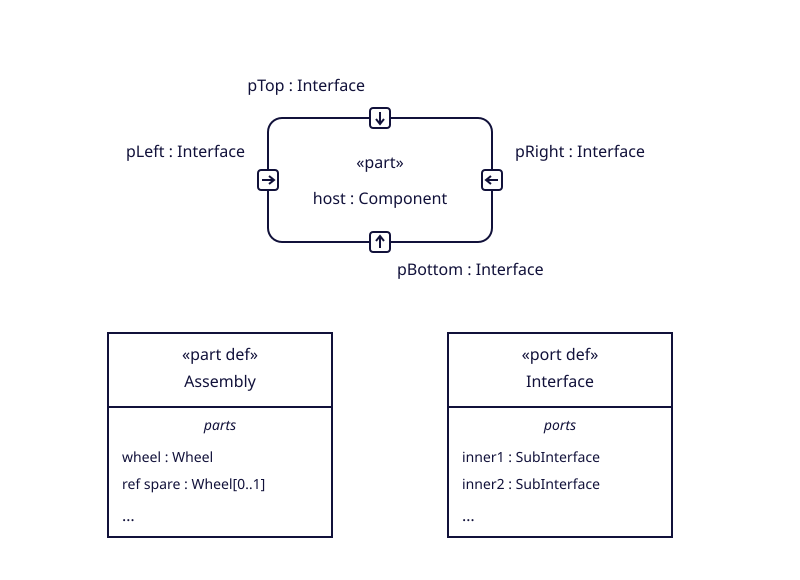

# Understand parts and ports

Use this reference to connect definitions, usages, ownership, composition and port notation. Follow one small assembly from its declarations to the reusable graphics, with original specification links beside the explanations.

This is a source-reviewed reference slice. The example has not been parser-validated or executed. The source is OMG SysML 2.0 Language, `formal/2026-03-02`; PDF page links below use one-based viewer pages, with the printed page number stated separately.

## Start with the distinction

| Concept | Question it answers | In the assembly example |
|---|---|---|
| Part definition | What kind of structural unit is described? | `Wheel`, `Axle`, `Assembly` |
| Part usage | How is that kind used in a context? | `wheel : Wheel`, `axle : Axle`, `assembly : Assembly` |
| Port definition | What kind of interaction point is described? | `Mount` |
| Port usage | Where is that interaction point used? | `hub : Mount` inside `Wheel`, and `mount : Mount` inside `Axle` |
| Connection usage | Which features are related by this connection? | `link` references `axle.mount` and `wheel.hub` |

A usage declaration describes features and their constraints; it is not evidence that a runtime object has been instantiated. A definition's features can be inherited by usages typed by it. [§7.6.1, printed 31–32 / PDF 63–64](https://www.omg.org/spec/SysML/2.0/Language/PDF#page=63), [§7.11, printed 58–61 / PDF 90–93](https://www.omg.org/spec/SysML/2.0/Language/PDF#page=90), [§7.12, printed 61–63 / PDF 93–95](https://www.omg.org/spec/SysML/2.0/Language/PDF#page=93).

The detailed profiles cover [PartDefinition](concepts/part-definition.md), [PartUsage](concepts/part-usage.md), [PortUsage](concepts/port-usage.md) and [ConnectionUsage](concepts/connection-usage.md). PortDefinition is explained here and linked to its [original declaration](https://www.omg.org/spec/SysML/20250201/SysML.xmi#Systems-Ports-PortDefinition); a full extracted property profile for it is still a separate inventory gap.

## Follow the assembly

The [complete original example](../data/examples/assembly.sysml) declares an empty `Mount` port definition, a wheel with a hub port, an axle with a mount port, and an assembly containing those parts. Its central declarations are:

```sysml
part def Assembly {
    part wheel : Wheel;
    part axle : Axle;
    ref part spare : Wheel[0..1];
    connection link connect axle.mount to wheel.hub;
}
part assembly : Assembly;
```

`Wheel` and `Axle` describe kinds. `wheel` and `axle` are feature usages declared in `Assembly`. `assembly` applies `Assembly` in the surrounding package context. `axle.mount` navigates from the axle usage to its port; it is a feature chain rather than simply a package-qualified name. [§7.6.2–3, printed 40–42 / PDF 72–74](https://www.omg.org/spec/SysML/2.0/Language/PDF#page=72), [§7.6.6, printed 43 / PDF 75](https://www.omg.org/spec/SysML/2.0/Language/PDF#page=75).

The binary connection shorthand names two referenced ends. It does not, by itself, describe payload transfer, a direction of flow, or executable behavior. The empty `Mount` definition in this example supplies no directed payload features from which a renderer could infer an arrow. [§7.13.2, printed 71 / PDF 103](https://www.omg.org/spec/SysML/2.0/Language/PDF#page=103).

## Separate ownership, composition and presentation

| Relationship | What to look for | Consequence |
|---|---|---|
| Declaration ownership | A declaration inside a namespace/definition/usage body, generally connected through owning membership | Identify who owns the declaration and which context it features. |
| Feature composition | Whether a usage is composite or referential under the applicable semantic rules | This concerns values, lifetime and sharing; it is separate from owning the declaration. |
| Graphical containment | A selected member drawn inside a node or compartment | This is a view/layout choice; it does not create an owning membership or change composition. |

`ref part spare` remains a PartUsage and remains an owned declaration of `Assembly`. The explicit `ref` makes that usage referential; it does not turn it into the metaclass ReferenceUsage. Its explicit `[0..1]` is a constraint in this model, not the default value of a metamodel property. [§7.5.2, printed 27 / PDF 59](https://www.omg.org/spec/SysML/2.0/Language/PDF#page=59), [§7.6.3–4, printed 42 / PDF 74](https://www.omg.org/spec/SysML/2.0/Language/PDF#page=74).

The browser's property bounds describe fields in the language metamodel. For example, a PartUsage property with a metamodel bound does not determine how many wheels this assembly has. Derived fields require their derivation rules, and contextual usage defaults require their own semantic conditions. [Property rules](research/property-rules.md), [§7.6.3, printed 41 / PDF 73](https://www.omg.org/spec/SysML/2.0/Language/PDF#page=73).

## Read the notation

| Form | What the reference supports | What remains a separate responsibility |
|---|---|---|
| Sharp definition node | Part-definition and port-definition keywords and editable names | Prefix combinations, aliases and full definition declarations |
| Rounded usage node | Part and port usage headers; dashed referential part envelope | Model context, inherited constraints and validity of supplied text |
| Parts or ports compartment | A selected heading, two editable literal rows and an elision marker | Member selection, arbitrary row counts, formatting and semantic validation |
| Direction-bearing boundary glyph | Horizontal or vertical arrow geometry in a rounded outline | Host boundary, side-specific labels, direction selection and restricted nested/reference/proxy cases |

See [parts grammar, printed 208–210 / PDF 240–242](https://www.omg.org/spec/SysML/2.0/Language/PDF#page=240) and [ports grammar, printed 210–214 / PDF 242–246](https://www.omg.org/spec/SysML/2.0/Language/PDF#page=242). Layout may stretch and relocate these components while preserving the applicable containment/connectivity rules. A compartment is a view selecting members; an ellipsis indicates elision, not a count of absent model elements. [§8.2.3.1, printed 193–194 / PDF 225–226](https://www.omg.org/spec/SysML/2.0/Language/PDF#page=225).



This is a separate, original rendering example, not a generated diagram of `AssemblyExample`. Its arrows and labels are supplied deliberately to demonstrate placement. The grammar's small left/right forms put labels outside and above, top forms above-left, and bottom forms below-right. A whole-symbol rotation also rotates its text and cannot replace position-aware labeling. [PDF 244–245 / printed 212–213](https://www.omg.org/spec/SysML/2.0/Language/PDF#page=244).

## Interpret ports carefully

A port usage is typed by port definitions. Conjugated typing can use `~` before the original port-definition name: it reverses `in` and `out` while retaining `inout`. This does not authorize adding a tilde to every graphical label grammar: the boundary `port-label` production is printed as a qualified name with an optional qualified type, whereas the compartment examples include conjugated types. [§7.12.3, printed 63 / PDF 95](https://www.omg.org/spec/SysML/2.0/Language/PDF#page=95), [boundary label, printed 214 / PDF 246](https://www.omg.org/spec/SysML/2.0/Language/PDF#page=246).

Ordinary `hub` and `mount` usages in the part definitions fall under referential-port restrictions. Nested ports are a qualified exception; do not generalize that every nested port must be noncomposite. The source's broad PortUsage description and its scoped well-formedness constraints must be read together. [§7.12.2, printed 63 / PDF 95](https://www.omg.org/spec/SysML/2.0/Language/PDF#page=95), [§8.3.12.6, printed 295–296 / PDF 327–328](https://www.omg.org/spec/SysML/2.0/Language/PDF#page=327).

Broken-outline reference ports are restricted to nested ports. Proxy points are restricted to a part usage within an interconnection view; their labels depend on the occurrence grammar's `proxy-label`, which uses an optional dot and FeatureChainMember. Those complete layouts remain deferred. [Proxy label, printed 207 / PDF 239](https://www.omg.org/spec/SysML/2.0/Language/PDF#page=239), [restriction notes, printed 214 / PDF 246](https://www.omg.org/spec/SysML/2.0/Language/PDF#page=246).

## Borrow components or inspect the gaps

Open the [SVG library](svg-shapes.html), [download the library ZIP](../shapes/catalog.zip), or use the [renderer guide](../shapes/README.md). Compartment nodes expose `label`, `row1` and `row2` text slots. Arrow glyphs expose center/edge anchors; choose their direction from the modeled context rather than from the drawing's position alone. Literal text editing does not parse SysML or validate the model.

The [selected source audit](parts-ports-notation-audit.md) accounts for all 12 source cells and 38 production occurrences with per-alternative assets, partial matches or explicit deferrals. It preserves source spelling inconsistencies, the table's inconsistent interconnection label, and unimplemented behavior/compartment dependencies. Its alternatives are bookkeeping records, not unique-symbol counts. The [coverage dashboard](notation-coverage.md) distinguishes these audits from indexing and rendering.

No parser, semantic engine, OCL evaluator or conformance suite was run. The example and redraws remain source-reviewed artifacts with the limits stated above.
