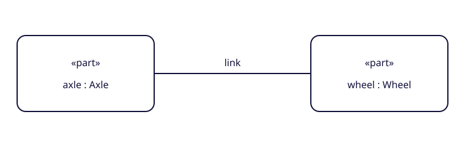

# Borrow the SVG shapes

The [shape gallery](svg-shapes.html) offers nine reusable components for parts, ports and connections. Download an [individual SVG or the complete ZIP](../shapes/catalog.zip), use the [symbol sprite](../shapes/shapes.svg), or try the [live renderer example](../shapes/examples/renderer.html).



The assets have transparent backgrounds and no research captions or logos. Original component artwork and helper code are licensed under [Apache 2.0](../shapes/LICENSE). The [manifest](../shapes/catalog.json) links each asset to official specification pages and indexed grammar occurrences, records its label slots, attachment points and SHA-256, and states its limits.

## Embed a file or symbol

```html


<svg viewBox="0 0 240 140" role="img" aria-label="Composite part usage">
  <use href="shapes/shapes.svg#sysml-part-usage"></use>
</svg>
```

Individual SVGs work in vector editors and image elements. Serve external sprite references from the same origin. A sprite symbol keeps the default example text; use an independent inline SVG to change its labels.

## Create an editable component

```js
import {createShape, loadCatalog, anchorPositions} from './shapes/renderer.mjs';

const node = await createShape('part-usage', {
  labels: {label: 'engine : Engine'},
  title: 'Engine part usage',
  theme: {stroke: '#11113a', fill: '#ffffff', text: '#11113a'},
  width: 240, height: 140
});
document.querySelector('#canvas').append(node);

const catalog = await loadCatalog();
const definition = catalog.shapes.find(shape => shape.id === 'part-usage');
const points = anchorPositions(definition, {x: 20, y: 50});
// points.east = {x: 252, y: 120}
```

The browser module has no package dependencies. Serve it over HTTP or HTTPS. It loads the sprite and manifest relative to itself, so copied folders work beneath a project path. Labels become text, not HTML. Keywords remain fixed. Theme variables affect inline SVG; page CSS cannot theme an SVG through an `img` element.

Attachment points are geometry coordinates, separate from the model's semantic ownership or featuring relationships. The helper accounts for aspect-ratio letterboxing. Resizing changes the viewport without reflowing labels; routing, layout, label measurement and SysML model validation belong to the host renderer.

## Scope and extension

The first set provides a part definition; composite and referential parts; a full port and boundary glyph; a full connection; binary and three-ended connections; and a binding edge. The port glyph needs host placement and a label. Node compartments, optional arrows, proxy/reference port variants and connection adornments remain outside this set.

The [bundle guide](../shapes/README.md) documents all files, customization options and rebuild instructions. The catalogue definitions are in [data/svg-shapes.json](../data/svg-shapes.json), with [RDF asset metadata](../data/rdf/svg-shapes.ttl) alongside the existing inventory. Asset count is distinct from notation-record or source-unit coverage: see the [coverage dashboard](notation-coverage.md).

## Verify reuse

The test suite checks manifest hashes, source mappings, clone-safe SVG structure, sprite equivalence, bundle contents and attachment-coordinate math. The retained [browser interaction check](../tests/shapes-browser-check.js) exercises filtering, the copy handler, the renderer example, plain-text labels, duplicate-ID avoidance and invalid options. It runs separately from the Python suite.

With a local site preview on port 8000 and Playwright CLI available, run:

```bash
playwright-cli open http://127.0.0.1:8000/docs/svg-shapes.html
playwright-cli run-code --filename=tests/shapes-browser-check.js
```

The copy-handler check uses a stub clipboard to verify the copied SVG without changing the system clipboard.
