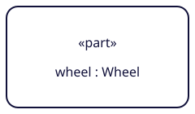

# Reusable SysML SVG components

Twenty original vector components for selected parts, ports and connections. They are small rendering assets, separate from the explanatory illustrations in `docs/assets/notation/`. Each has a transparent canvas, source/license metadata and a manifest entry with its supported scope.

Licensed under Apache 2.0; see [LICENSE](LICENSE). Copyright 2026 Dynamical Systems Group. These are original redraws, not copied OMG figures. The cited specification retains its own terms. The bundle contains no DSG logo, external font, downloaded specification or runtime dependency.

## Files

- `svg/`: one standalone SVG per component.
- [catalog.json](catalog.json): stable IDs, viewBoxes, SHA-256 hashes, label slots, attachment coordinates, source URLs, source hash and limitations.
- [shapes.svg](shapes.svg): a sprite with `sysml-` prefixed symbol IDs.
- [renderer.mjs](renderer.mjs): optional browser ES module for editable labels, themes and attachment coordinates.
- [examples/composition.svg](examples/composition.svg): self-contained composition of two part usages and a connection.
- [examples/parts-ports.svg](examples/parts-ports.svg): original four-side boundary placement and selected compartment composition. Arrow choices are explicit drawing inputs.
- [examples/renderer.html](examples/renderer.html): live module example. Serve this folder over HTTP to run it.

## Use a standalone asset

```html

```

Standalone SVGs also open in vector editors. There is no poster background, source caption or logo to remove. The small boundary port is deliberately a **glyph only**: the host renderer supplies the boundary placement and appropriate label. The undirected `port-glyph` is only an outline primitive; the displayed boundary grammar includes direction indicators. Six `port-arrow-*` components provide horizontal/vertical indications without inferring direction semantics.

## Use the sprite

```html
<svg viewBox="0 0 240 140" width="240" height="140"
     role="img" aria-label="Composite part usage">
  <use href="shapes.svg#sysml-part-usage"></use>
</svg>
```

External sprite references are best served from the same origin. They use the default example text. To change text, create an independent inline component with the module or edit a standalone SVG. The component bodies contain no IDs, so cloning a component does not create duplicate title, marker or label IDs.

## Set labels and theme in a browser renderer

```js
import {createShape, loadCatalog, anchorPositions} from './renderer.mjs';

const node = await createShape('part-usage', {
  labels: {label: 'engine : Engine'},
  title: 'Engine part usage',
  theme: {stroke: '#11113a', fill: '#ffffff', text: '#11113a'},
  width: 240,
  height: 140
});
document.querySelector('#canvas').append(node);

const catalog = await loadCatalog();
const definition = catalog.shapes.find(shape => shape.id === 'part-usage');
const anchors = anchorPositions(definition, {x: 20, y: 50});
// anchors.east is {x: 252, y: 120} in the host coordinate system.
```

`createShape` returns an SVG element. `labels.label` edits the name/type or edge text as plain text, never markup. The compartment nodes also expose `row1` and `row2`; these are literal text slots, not parsed declaration objects. For example, `createShape('part-definition-parts', {labels: {label: 'Assembly', row1: 'wheel : Wheel', row2: 'ref spare : Wheel[0..1]'}})` supplies a fixed two-row parts compartment with an elision marker. Keywords and the binding equals sign stay fixed. Passing an empty edge label removes its visible text; labels on nodes remain the caller's responsibility. Unknown shape IDs, label slots and theme options throw errors. Width and height must be positive finite numbers.

Theme keys are `stroke`, `fill`, `text`, `strokeWidth` and `fontFamily`, corresponding to `--sysml-stroke`, `--sysml-fill`, `--sysml-text`, `--sysml-stroke-width` and `--sysml-font`. CSS variables apply when SVG is inline or used through a sprite. CSS on an HTML page does not reach inside an `` document; edit its SVG or use the module to theme it.

The supplied anchors refer to geometry in viewBox coordinates. `anchorPositions` applies the default `xMidYMid meet` scaling, including letterbox offsets when width and height have different aspect ratios. Strokes do not scale. Width/height resize the viewport; they do not reflow labels or change the node's geometry. A host renderer should measure text, wrap it or generate a larger node when needed. These files do not provide automatic text layout, arbitrary connection routing, hit testing or a SysML validator.

## Compose and extend

Use node `north`, `east`, `south` and `west` points for attachment. Binary edges expose `start`/`end`. The boundary-port glyph has `center` and four edge points; center it on its host boundary before routing. The n-ary example exposes `junction` and three endpoints. Connection endpoint kinds, port placement, direction, multiplicities and type compatibility still follow the cited grammar and modeled semantics.

Every asset records limitations. This is an initial library, not exhaustive graphical-notation coverage. Selected two-row parts/ports compartments and six direction glyphs are supplied. Arbitrary compartment stacks and row counts, aliases, nested/reference/proxy port layouts, direction-selection semantics and connection adornments remain unimplemented. A complete boundary form also needs its position-specific label; rotating a whole symbol does not keep its text upright. Changing a label is not proof that a new notation is permitted.

Curated definitions live in `data/svg-shapes.json`. Rebuild from the repository root:

```bash
uv run --locked python scripts/build_shapes.py
```

This regenerates standalone SVGs, sprite, manifest, RDF, gallery, composition example and the deterministic ZIP bundle. `renderer.mjs`, this guide and the live HTML example are maintained source files. New assets must cite indexed production IDs and source pages, record scope and anchors, and receive visual inspection.
